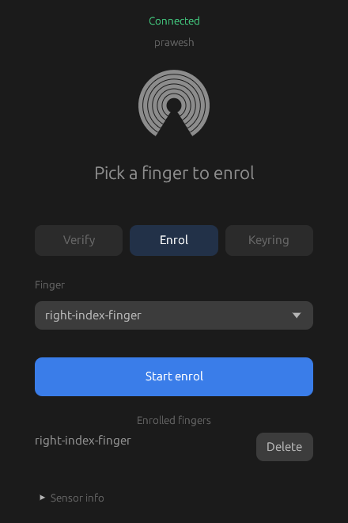
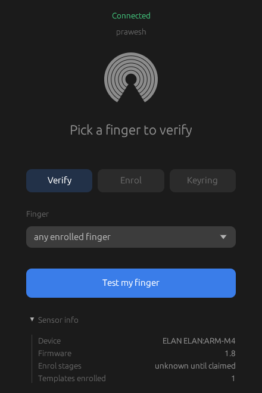
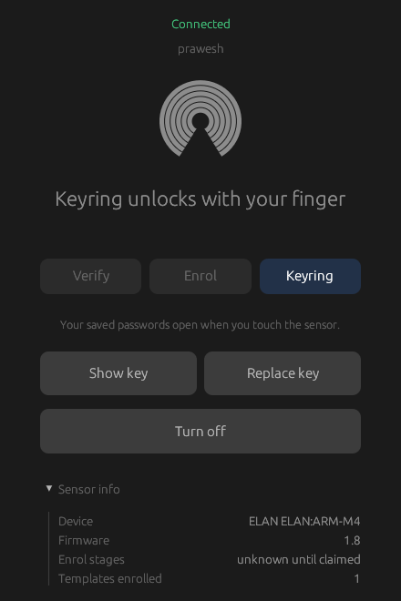
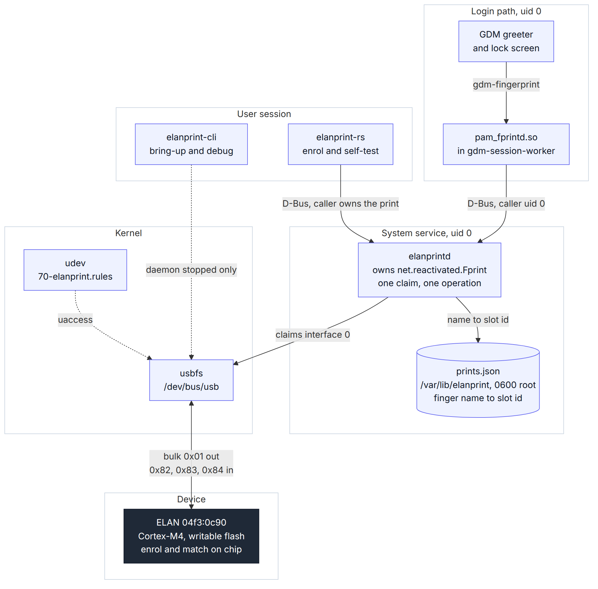
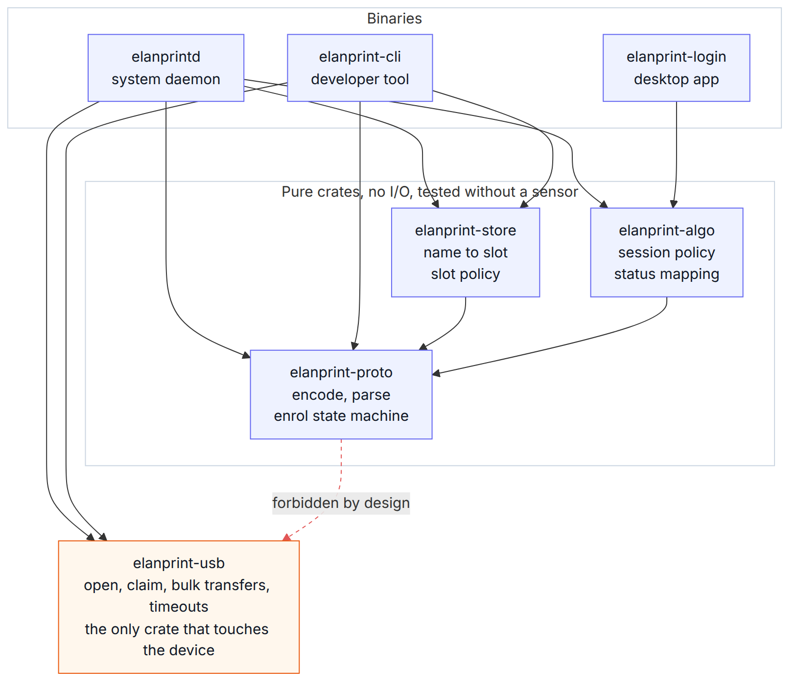
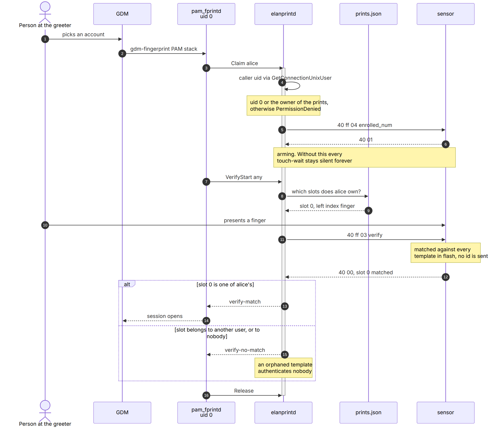

# elanprint-rs

A userspace fingerprint driver for the ELAN `04f3:0c90` sensor. Pure Rust:
no kernel module, no libfprint, no C dependencies.

On a stock Linux install the sensor does nothing, because libfprint has no entry
for this product id. This project talks to the sensor directly over USB and
answers fprintd's D-Bus interface, so the GDM login screen and the GNOME lock
screen can unlock with a finger.

The sensor does the matching itself. It is an ARM Cortex-M4 with its own writable
flash, and enrolment, template storage and matching all happen in its firmware.
The host sends short vendor commands and reads replies of two or three bytes. No
fingerprint image crosses the USB bus; the host only learns which slot matched.

The daemon claims USB interface 0 through usbfs and speaks the protocol in
`docs/protocol.md`.

---

## Table of contents

- [Do I have this sensor?](#do-i-have-this-sensor)
- [Requirements](#requirements)
- [Install](#install)
  - [From a release](#from-a-release)
  - [From source](#from-source)
  - [Templates outlive the uninstall](#templates-outlive-the-uninstall)
  - [Development mode](#development-mode)
- [Preview](#preview)
- [Status](#status)
- [Use](#use)
- [Keyring unlock](#keyring-unlock)
- [What this project found](#what-this-project-found)
- [Tech stack](#tech-stack)
- [Folder structure](#folder-structure)
- [Architecture](#architecture)
  - [Crate layering](#crate-layering)
  - [The login path](#the-login-path)
- [Safety](#safety)
- [Unverified elsewhere](#unverified-elsewhere)
- [What is next](#what-is-next)
- [Development](#development)
- [Credits](#credits)
- [License](#license)

---

## Do I have this sensor?

```bash
lsusb -d 04f3:0c90
```

One line back means yes:

```text
Bus 001 Device 002: ID 04f3:0c90 Elan Microelectronics Corp. ELAN:ARM-M4
```

Nothing back means this driver does not support your sensor. The other ELAN ids
(`0c00`, `0c4c`, `0c5e`) speak a related but different protocol, and sending
0c90 bytes to them is not safe. The driver refuses any ELAN sensor it does not
recognise instead of probing it.

Check your Ubuntu version too:

```bash
lsb_release -d      # 24.04 or newer
```

---

## Requirements

This driver supports exactly one sensor: `04f3:0c90`.

- Ubuntu 24.04 or newer. Older releases and other distributions are untested;
  the installer warns but does not refuse.
- Linux with usbfs. `nusb` talks to `/dev/bus/usb` directly.
- systemd and logind. The unit runs the daemon, and the daemon follows logind's
  `PrepareForSleep` signal to release the device over a suspend.
- The D-Bus system bus, to own `net.reactivated.Fprint`.
- `libpam-fprintd`. This driver answers fprintd's D-Bus interface, and fprintd's
  own PAM module does the authentication.
- `getent` from `libc-bin`, to resolve account names through NSS. Every normal
  install has it.
- Rust 2021, only if you build from source. The released `.deb` needs no
  toolchain.

---

## Install

You can install the released package or build from this checkout. Both put the
same files in the same places.

Both mask `fprintd.service`. It owns `net.reactivated.Fprint` and has no driver
for this sensor, so it would only race this daemon for the name. Uninstalling
unmasks it again.

Nothing under `/etc/pam.d` is touched. Ubuntu already ships
`/etc/pam.d/gdm-fingerprint` with `auth required pam_fprintd.so` and no
`@include common-auth`.

### From a release

```bash
curl -fsSLO https://github.com/prawesh-12/elanprint-rs/releases/latest/download/elanprint-rs_amd64.deb
sudo apt install ./elanprint-rs_amd64.deb
```

amd64 only. No Rust toolchain needed, and apt pulls in `libpam-fprintd` if it is
missing.

The package installs the daemon to `/usr/libexec/elanprintd` and the app to
`/usr/bin/elanprint-rs`, with the CLI at `/usr/libexec/elanprint-cli` and the
setup tool at `/usr/bin/elanprint-keyring`. The systemd unit and the udev rule
go under `/usr/lib`. It creates an empty `/var/lib/elanprint` for the slot
mapping and starts the daemon.

Check that it came up:

```bash
systemctl is-active elanprintd
busctl --system status net.reactivated.Fprint
```

The second command should report `elanprintd` as the owner. To remove it:

```bash
sudo apt remove elanprint-rs     # keeps the slot mapping
sudo apt purge elanprint-rs      # deletes it too
```

### From source

```bash
cargo build --release --workspace
sudo ./tools/install.sh
```

The installer checks the machine before it changes anything. It refuses when the
sensor is missing or is a different ELAN id. It warns when Ubuntu is older than
24.04, when the distribution is not Ubuntu, when `/etc/pam.d/gdm-fingerprint` is
missing, and when `pam_fprintd.so` is not installed. Afterwards it checks that
the process owning the bus name is the binary it just installed.

The store starts empty and is never seeded. Enrolling a finger writes it.

To undo everything:

```bash
sudo ./tools/uninstall.sh
```

That removes the binary, the unit and the udev rule, and unmasks fprintd. It
keeps the store. Password login is never affected.

To build the package yourself:

```bash
./tools/package-deb.sh          # writes target/deb/elanprint-rs_<version>_amd64.deb
```

### Templates outlive the uninstall

Uninstalling erases nothing from the sensor. Templates live in the chip's own
flash, and neither a reinstall nor a wiped host store removes them.

The uninstaller tells you how many remain, but the host cannot list them:
`finger_info` returns the same bytes for an occupied slot and an empty one. The
login path only accepts slots that the claiming user owns, so a template left by
a previous owner cannot authenticate as somebody else.

If you are passing the machine on, erase them:

```bash
sudo ./tools/uninstall.sh --wipe-device
```

That asks for typed confirmation and refuses to run without a terminal. It sends
`wipe_all`, which is documented but untested on hardware, then reads the count
back to check.

`--delete-store` removes the host mapping as well. It warns when templates
remain, because deleting the mapping is what orphans them.

### Development mode

Dev mode runs on the session bus with a throwaway store, so the installed daemon
and `/var/lib/elanprint` are left alone. No root needed.

```bash
./tools/dev.sh status      # sensor, service, bus owner, dev store
./tools/dev.sh up          # daemon and app together
./tools/dev.sh daemon      # daemon only, debug logging
./tools/dev.sh cli info    # elanprint-cli against the dev setup
./tools/dev.sh clean       # delete the dev store
```

Dev mode cannot share the sensor, so stop the service first. `dev.sh` says so
instead of failing with "Device or resource busy".

```bash
sudo systemctl stop elanprintd
```

---

## Preview

<p align="center">
  
  
  
</p>

The app enrols fingers, deletes them, and runs a self-test against the sensor.
The third tab sets up keyring unlock, which stays off until you turn it on.

The app is not an authentication surface. Real login goes through PAM, and the
app unlocks nothing.

---

## Status

It works. Every number below comes from one test machine: Ubuntu 24.04.4 LTS,
kernel 7.0.0-31-generic, GNOME Shell 46.0, fprintd 1.94.3, x86_64.

It also runs on Ubuntu 26.04.1: fingerprint login works there and
`cargo test --workspace` passes, but the hardware tests have not been repeated
on that release.

| Works | Evidence |
| ----- | -------- |
| Enrol, 8 touches, writes flash | `commit` answered `40 00` in 102 to 103 ms |
| Verify a known finger | 10 of 10 matches, plus 5 of 5 in a later run |
| Reject an unknown finger | 10 of 10 no-match, zero retries |
| Two fingers in separate slots | left index matched slot 0, right index slot 1 |
| Template survives a reboot | count `40 01` and a match after a power cycle |
| Lock screen unlock | opened by the `gdm-fingerprint` PAM service |
| Greeter login after logout | `session opened for user ... (gdm-fingerprint)` |

Eight of the sixteen commands in `docs/protocol.md` are marked `confirmed`.
Those were sent to real hardware and the replies recorded. The other eight are
`documented`: the bytes come from the `0c4c` project and have never been sent.

Three parts are borrowed or untested. `delete` has not run under the current
code. `wipe_all` has never run at all. The 8 touch enrol count came from `0c4c`;
nothing on this chip reports a stage count.

---

## Use

Enrol and delete through the app, or through any fprintd client. The CLI is for
reading state and debugging.

The CLI installs to `/usr/libexec/elanprint-cli`, which is not on `PATH`. From a
checkout:

```bash
cargo build -p elanprint-cli
./target/debug/elanprint-cli info          # firmware, sensor size, count. read only
./target/debug/elanprint-cli probe         # open, list endpoints, release. sends nothing
./target/debug/elanprint-cli verify        # wait for a touch, report the match
./target/debug/elanprint-cli slots --prime # read every slot record
./target/debug/elanprint-cli sync --store PATH   # host mapping against the chip
```

`enroll` writes flash. `enroll-plan` prints the bytes it would send without
sending them. Both exist for bring-up, not for daily use.

The daemon holds USB interface 0 for as long as it runs, so the CLI reports
"Device or resource busy" until you stop the service.

---

## Keyring unlock

You log in with your finger and the desktop opens. Then a dialog asks for your
password, because the Wi-Fi or a browser wanted a saved secret. The log says:

```text
gdm-fingerprint: gkr-pam: no password is available for user
gdm-fingerprint: pam_unix(gdm-fingerprint:session): session opened for user
gdm-fingerprint: gkr-pam: couldn't unlock the login keyring
```

The login worked; the keyring did not open. This is not a fault in this driver.
It happens with every fingerprint reader on Linux, including the ones libfprint
has supported for years.

### Why the keyring stays locked

The login keyring is encrypted with your account password. `pam_gnome_keyring`
reads that password from `PAM_AUTHTOK`, which a password module sets earlier in
the PAM stack. `pam_fprintd` never sets it: a fingerprint is not a password and
cannot be turned into one. This chip answers a match with two bytes, `40 00`, and
there is no key in that.

macOS and Windows keep the password wrapped in a security chip and release it
when the biometric matches. GNOME has nothing equivalent, so `gnome-keyring`
takes a typed password or stays locked.

### How this project fixes it

Ubuntu's `/etc/pam.d/gdm-fingerprint` already runs `pam_gnome_keyring` on every
fingerprint login. Only the authtok is missing.

The setup keeps a random 32 byte secret sealed in the TPM, re-keys the login
keyring to that secret, and adds a small PAM module that hands the secret over
once `pam_fprintd` succeeds:

```text
finger matches
  -> pam_fprintd returns success
  -> pam_elanprint_keyring unseals the secret, sets PAM_AUTHTOK
  -> pam_gnome_keyring reads it and unlocks the keyring
```

Your account password is never stored. The module cannot block a login: every
path returns `PAM_IGNORE`, including a dead TPM or a panic, so a failure leaves
you exactly where you were before.

Turn it on from the app's Keyring tab, or from a terminal:

```bash
elanprint-keyring enable
elanprint-keyring status
elanprint-keyring rotate     # replace the key
elanprint-keyring disable
```

Nothing is wired until you run `enable`.

The trade-off: a matching finger then releases every secret in the login
keyring, not just the session. You also get a recovery key, which is the only
way in if the TPM stops unsealing. [docs/keyring.md](docs/keyring.md) covers the
design, every file it writes, what happens when each part fails, and how to
recover.

---

## What this project found

Everything below is recorded with raw bytes in `docs/protocol.md` and
`docs/findings.md`. Four things were not what the documentation predicted.

**The arming rule.** `verify` (`40 ff 03`) answers only if `enrolled_num`
(`40 ff 04`) went first, on the same claim. Without it the chip accepts the
command and then sends nothing, on any endpoint, indefinitely. It returns no
error.

**Slots cannot be scanned.** `finger_info` is supposed to describe one slot. On
`0c90` every slot id returns the same two bytes, `40 ff`, whether it holds a
template or not. `enrolled_num` is the only reading that proves anything, so an
enrolment that trusts a slot scan can overwrite a live template. This driver
floors new slots at that count.

**`verify` carries no finger id.** The command matches against every template on
the chip and returns whichever slot hit. A caller that wants to verify a named
finger has to compare the returned slot against that user's slots; otherwise any
template on the chip would authenticate any account, including one a previous
owner left in flash.

**The three IN endpoints are not interchangeable.** `0x82` is image, `0x83` is
status, `0x84` is touch-wait. Reading the wrong one does not fail; the read waits
until it times out. Inside one enrolment the replies alternate: the samples
answer on `0x84`, the collision check and `commit` on `0x83`.

---

## Tech stack

| Layer | Used |
| ----- | ---- |
| Language | Rust 2021 |
| USB transport | `nusb`, straight to `/dev/bus/usb` |
| Async runtime | `tokio` |
| D-Bus | `zbus` |
| Desktop app | `eframe` / `egui` |
| Service | systemd unit, udev rule with `uaccess` |
| Auth | PAM through `pam_fprintd` |

`nusb` speaks usbfs directly, so there is no libusb, no libfprint and no glib to
build against.

---

## Folder structure

```
elanprint-rs/
├── crates/
│   ├── elanprint-usb/            moves bytes, picks no endpoints, knows no opcodes
│   ├── elanprint-proto/          command encoding, response parsing, enrol state machine
│   ├── elanprint-store/          user and finger name to on-chip slot, slot policy
│   ├── elanprint-algo/           login decision engine, status mapping
│   ├── elanprintd/               the system daemon, owns net.reactivated.Fprint
│   ├── elanprint-cli/            debug and bring-up tool
│   ├── elanprint-login/          the desktop app, not an auth surface
│   ├── pam-elanprint-keyring/    PAM module that unlocks the login keyring
│   └── elanprint-keyring-setup/  the setup behind the Keyring tab and the CLI
├── docs/
│   ├── protocol.md               the command table; nothing reaches the device unless it is here
│   ├── findings.md               what the device actually did, append only
│   └── keyring.md                the keyring problem, the fix, and its trade-offs
├── systemd/ udev/ polkit/ dbus/  install artefacts
├── desktop/                      the .desktop entry for the app
├── packaging/deb/                postinst, prerm and postrm for the .deb
├── assets/                       screenshots and architecture diagrams
└── tools/                        install, dev, packaging and capture scripts
```

Only `elanprint-usb`, `elanprintd` and `elanprint-cli` need real hardware.
Everything else builds and tests with no sensor attached.

---

## Architecture

Whoever claims USB interface 0 keeps it until that process exits. Normally that
is `elanprintd`, running as root and owning `net.reactivated.Fprint` on the
system bus, so the login path and the app go through one arbiter instead of
racing.

The diagram is grouped by privilege boundary. A solid arrow is the normal path,
a dashed arrow is conditional.

<p align="center">
  
</p>

The store holds no biometric data. The mapping file turns a slot id back into a
finger name, and keeps enrolment from reusing a slot.

### Crate layering

An arrow means depends on, and it only points downward. `elanprint-proto` is
never allowed to reach the transport.

<p align="center">
  
</p>

`elanprintd` is generic over a `Transport` trait, and tests drive it against a
fake that records every byte. A test asserts that no `delete`, `delete_subsid`
or `wipe_all` opcode ever reaches the wire.

| Crate | Does | Needs hardware |
| ----- | ---- | -------------- |
| `elanprint-usb` | moves bytes, picks no endpoints, knows no opcodes | yes |
| `elanprint-proto` | command encoding, response parsing, enrol state machine | no |
| `elanprint-store` | user and finger name to on-chip slot, slot policy | no |
| `elanprint-algo` | login decision engine | no |
| `elanprintd` | the daemon, owns `net.reactivated.Fprint` | through a trait |
| `elanprint-cli` | debug and bring-up tool | yes |
| `elanprint-login` | the desktop app | no |
| `pam-elanprint-keyring` | hands the sealed secret to `pam_gnome_keyring` | no |
| `elanprint-keyring-setup` | the setup behind the Keyring tab and the CLI | no |

### The login path

The session has to be armed before any touch-wait command. The slot the chip
returns has to be checked against the slots the claiming user owns.

<p align="center">
  
</p>

`verify` carries no finger id, so without that slot check any enrolled template
would authenticate any account, including one a previous owner left in flash.

The workspace has 145 tests. 144 run with `cargo test --workspace`; one is
ignored by default. None of them need the sensor.

---

## Safety

The sensor's flash is writable and there is no reflash path. A wrong command can
leave the hardware unusable, with no way to recover it in software. The safety
rules are:

- Nothing is sent unless it appears in `docs/protocol.md`.
- Opcodes are never guessed or looped over. Walking a range of opcode values on
  a flash-capable MCU is fuzzing it.
- `delete`, `delete_subsid` and `wipe_all` erase, and there is no undo. Erase is
  reachable from one function only, and only with a value built from an explicit
  user request. No comparison between the host mapping and the chip reaches it.
- The host mapping never overrides chip flash. Enrolment is floored at
  `enrolled_num`, so a host file that disagrees with the device can never hand
  out a slot the device says is in use.
- Every error path sends `abort` (`40 ff 02`) before releasing the interface.
  Without it the chip stays mid-session and the next command reads a stale
  reply.

---

## Unverified elsewhere

All testing so far has been on one machine, so these are the parts most likely
to differ on yours. `docs/findings.md` takes results if you run it.

**Firmware.** One unit, reporting 1.8. The daemon logs the version on its first
claim, so a difference shows up in `journalctl -u elanprintd`. Two findings may
be specific to this revision: the arming rule, and `0xff` from `finger_info`
meaning an empty slot. On the `0c4c` family the same byte reads as a stuck
sensor; here it means empty. When a touch-wait times out, the daemon says the
arming rule may not hold on that firmware instead of reporting a plain timeout.

**The 8 touch count** comes from `0c4c`. Nothing on this chip reports a stage
count, so the value is a guess that works on the tested unit. Override it:

```bash
sudo systemctl edit elanprintd     # Environment=ELANPRINT_ENROLL_STAGES=10
```

The range is 1 to 32; anything else falls back to 8. The value in use is logged
at startup and on every enrol, next to the firmware version, so a wrong guess
shows up in the log instead of hanging.

**`wipe_all` has never run.** `--wipe-device` implements it from the documented
bytes and reads the count back afterwards. Treat the first run as a test.

**The number of slots is unknown.** The `0c4c` formula that builds `commit`
breaks from slot 11 upward, so higher slot numbers are untested.

**False accepts.** A false accept rate and fake finger detection cannot be
measured with one sensor, so the project makes no claims about either.

**Other hardware.** A second `0c90` unit, a second firmware revision and every
non-Ubuntu distribution are untested.

**Desktops other than GNOME.** Login works here because Ubuntu ships
`/etc/pam.d/gdm-fingerprint`. KDE, Cinnamon and XFCE do not have that file.
Enrol and verify would still work, but greeter login would need PAM
configuration that this project does not touch.

---

## What is next

- Move the permission checks to polkit. The policy file is already in the repo.
- Confirm the enrolment touch count on this chip.
- Test on other `04f3:0c90` units, especially with a different firmware
  revision.

---

## Development

```bash
./tools/check.sh    # build, test and clippy across the workspace
```

Clippy runs with `-D warnings`, and `unwrap` and `expect` are denied outside
tests.

`docs/findings.md` is append only. When a response does not match the documented
layout, the device is right and the document is wrong. Record the difference
rather than bending the parser to fit.

---

## Credits

The protocol groundwork comes from [`depau/elanpoc`](https://github.com/depau/elanpoc)
by Davide Depau (MIT). It is a proof of concept for the ELAN `0c4c` family and
does not cover `0c90`.

The opcode table, the `commit` sub id formula and the shape of the enrol
sequence came from that project. They stay marked `documented` until they run
here. The differences table is the gap between that family and this sensor,
measured on this hardware.

No source code from `elanpoc` is present. Every line of Rust in `crates/` was
written for this project.

---

## License

MIT. ([LICENSE](LICENSE))

The protocol documentation in `docs/protocol.md` derives from `depau/elanpoc`,
also MIT, and keeps its attribution.
